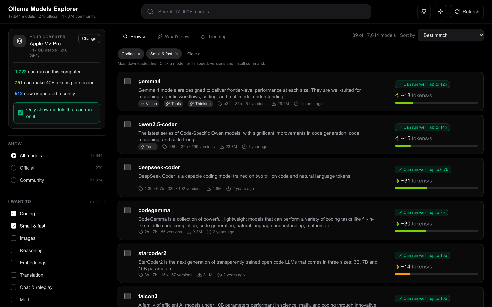
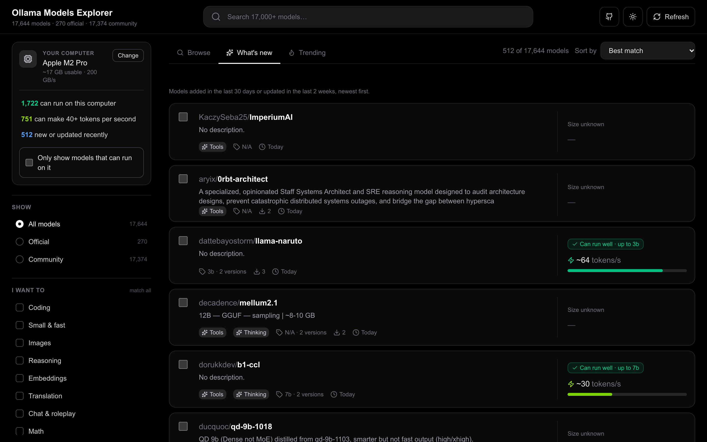
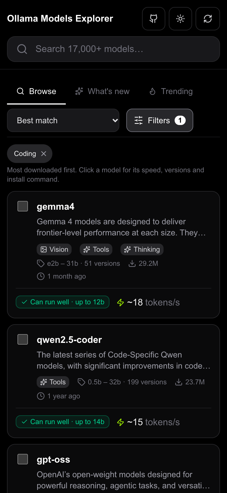
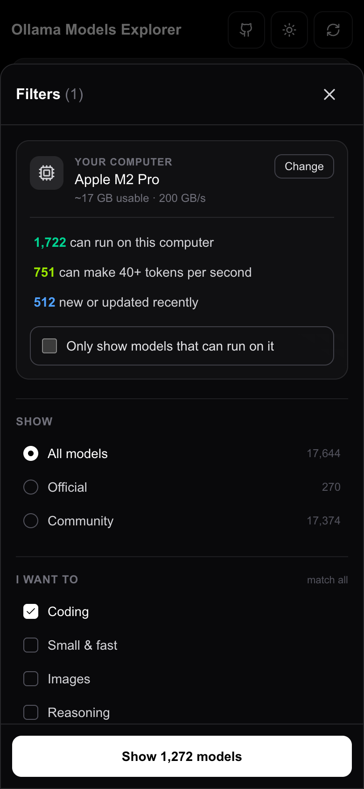

# Ollama Models Explorer

**Find the right Ollama model for your computer.** Search all 17,000+ models, see which ones can run on your hardware and how fast, compare them, and copy the install command.

**Live:** https://ollama-models-explorer.vercel.app/ (see [Please self-host it](#please-self-host-it))


## Why I built this

Like many people, I want to run local models. But on Ollama's own website you cannot see what you need to choose one. It does not tell you which models will run on a computer like mine, how big each one really is, or how fast it will be. I do not have high-end hardware, so a wrong pick means a big download that is too slow or does not run at all.

So I made a list I can actually decide from. It finds your computer on its own, then shows for every model: can it run here, how many tokens per second to expect, the size, the context window and what it is good at. Filters like "Coding" or "Small & fast" cut 17,000 models down to a few you can try. I hope it saves you the same trouble.

## Please self-host it

The public site runs on a free host. It is not very fast and it is not always up. **If you can, run your own copy.** It takes a minute, it is faster on your machine, and it works offline once the list is saved:

```bash
git clone https://github.com/p32929/ollama_models_explorer.git
cd ollama_models_explorer
yarn install && yarn dev     # then open http://localhost:3000
```

Or deploy it to Vercel, Netlify or any Node host. If you like it, a star on GitHub helps other people find it.

## Screenshots

**Pick what you want to do.** Tick "Coding" and "Small & fast", and hide everything your computer cannot run:



**Sort by the fastest on your computer.** Official models with tool support, fastest first, with an estimate of tokens per second:


**Filter by what a model can do.** For example, official models that understand images:


<p align="center">
  
  
</p>

<p align="center">
  
  
</p>

<p align="center">
  
</p>

**On a phone**, the filters open as a bottom sheet and each model is a card:

<p align="center">
  
  
  
</p>

## Features

**Every model on Ollama.** The ~270 official models (with every version, size and context window) **and the 17,000+ community models** (`user/model-name`), Choose All, Official or Community in the filter panel.

**Will it run on my computer, and how fast?** The page finds your graphics card (or Apple chip) and memory by itself, with nothing to type, marks every model **Can run well / Barely fits / Too big to run / Cloud**, and estimates **tokens per second** (about 0.75 words each), for example `~27 tokens/s`. If the guess is wrong, one tap picks the closest computer. "Only show models that can run on it" hides the rest. (Browsers hide exact specs, so it is an estimate. Speed = memory speed × 0.65 ÷ the model's size; mixture-of-experts models, which only use part of themselves for each word, are handled; expect ±30%. Official models use real download sizes, the rest are estimated from the parameter count.)

**Hover anything** (a badge, a number, a tab, a button) for a tooltip that says in plain words what it means and how it was worked out.

**Click any model** for a details panel: will it run and how fast, the exact `ollama run` command (with a copy button, including the best version for your computer), every version with its size and speed, context window, downloads and more.

**Find the right one**
- **I want to…** (pick several, a model must match all): Coding, Small & fast, Images, Reasoning, Embeddings, Translation, Chat & roleplay, Math, Tool use
- **Capabilities** (also several): Tools, Vision, Thinking, Embedding, Audio, Cloud…
- **Search** by any words in the name, description or capabilities; **Search ollama.com live** for anything newer than the saved list
- **Filters**: updated recently, size, context window, publisher (click a name), hide near-duplicates, capabilities
- **Sort** by downloads, last update, name, size, context window, versions or **speed on your computer**; **filter** by minimum speed (10, 20 or 40+ tokens/s)
- **At a glance**: how many models can run on your computer, how many are fast, how many are new
- **Always-open filter panel** on the left, so you can see and change every filter at once

**Compare** up to four models side by side (size, context, downloads, whether each runs on your computer).

**What's new / Trending**: models added or updated in the last two weeks, and what is rising. Trending ranks by real download growth once the list has two weekly snapshots, and by downloads plus recent updates until then.

**Made for phones**: models stack as cards, filters open as a bottom sheet, compare goes full screen, and every button is easy to tap.

**Shareable links**: search, filters, sort and the compare list are saved in the address.

**Light and dark mode**, and a **Model of the week**.

**For developers**
- JSON API: `GET /api/v1/models?q=coder&scope=community&cap=tools&sort=downloads&limit=50` (also `owner`, `updated`, `max_gb`, `min_context_k`, `new=1`, `memory_gb=16&bandwidth_gbs=200` to get a `fit` and an estimated `tokens_per_second` for that computer, `min_tps=20`, `sort=speed`). CORS is open.
- RSS feed of new and updated models: `/feed.xml`

### Where the full list comes from

ollama.com has no "list everything" page, so a small crawler builds `public/ollama-catalogue.json`:

```bash
node scripts/crawl-catalogue.mjs           # about 20 minutes, no dependencies
node scripts/crawl-catalogue.mjs --quick   # a 1-minute sample (written to a temporary file)
```

Each run compares with the previous list to record when a model first appeared and how many downloads it gained. A GitHub Action (`.github/workflows/update-catalogue.yml`) runs it every week and commits the new list.

### Tests

```bash
yarn test         # the logic: fit, device detection, filters, links (Node 22.6+)
yarn test:e2e     # browser tests on desktop and phone sizes, plus the API (uses your installed Chrome)
```

## Getting Started

See [Please self-host it](#please-self-host-it). `npm run dev` or `pnpm dev` work too. Open http://localhost:3000.

## Data Source

The official models are read live from ollama.com. The complete list (official and community) comes from `/public/ollama-catalogue.json`. The data includes:

- Model name and description
- Capabilities (chat, vision, etc.)
- Version information
- Size and context window details
- External links

## Technologies

- **Next.js**: React framework for production
- **TypeScript**: Type-safe code
- **Tailwind CSS**: Utility-first CSS framework
- **shadcn/ui**: Component library for the UI elements
- **Lucide React**: Icon library

## Contributing

Contributions are warmly welcomed and greatly appreciated! Whether it's a bug fix, new feature, or improvement, your input helps make this project better for everyone.

Before submitting a pull request, please:

1. Create an issue describing the feature or bug fix you'd like to work on
2. Wait for discussion and approval to ensure alignment with project goals
3. Fork the repository and create your feature branch
4. Submit your pull request with a clear description of changes

This approach helps avoid duplicate efforts and ensures smooth collaboration. Thank you for considering contributing!

## Share

Sharing this repository with your friends is just one click away from here

[](https://www.facebook.com/sharer/sharer.php?u=https://github.com/p32929/ollama_models_explorer/)
[](https://twitter.com/intent/tweet?url=https://github.com/p32929/ollama_models_explorer/)
[](https://www.tumblr.com/share?v=3&u=https://github.com/p32929/ollama_models_explorer/)
[](https://getpocket.com/save?url=https://github.com/p32929/ollama_models_explorer/)
[](https://pinterest.com/pin/create/button/?url=https://github.com/p32929/ollama_models_explorer/)
[](https://www.reddit.com/submit?url=https://github.com/p32929/ollama_models_explorer/)
[](https://www.linkedin.com/shareArticle?mini=true&url=https://github.com/p32929/ollama_models_explorer/)
[](https://api.whatsapp.com/send?text=https://github.com/p32929/ollama_models_explorer/)

---

## Support

If this saved you time, you can buy me a coffee — it keeps these projects maintained and free.

[](https://www.buymeacoffee.com/p32929)

<!-- hire-block -->

---

## 💼 Using this at a company?

I do fixed-price delivery work on my own projects. One invoice, one date, no hourly billing:

| | |
|---|---|
| **White-label build** — this project rebranded, extended and deployed as yours | **$6,500** · 3 weeks |
| **Custom app from scratch** on my own stack, signed and auto-updating | **$12,500** · 6 weeks |
| **Production-hardening sprint** — 72 hours on this project, for your load and your security review | **$999** |
| **Ongoing capacity** — one project-week of my time reserved every month | **$9,000 / month** |

Full details → **[p32929.github.io/hire](https://p32929.github.io/hire/)** · Email **[fayazdevinbox@uberip.com](mailto:fayazdevinbox@uberip.com)** — scoping and quotes are free and I answer within one business day.

### Commercial use of this repo

This repo has **no license file**, which in copyright law means *all rights reserved*.
Personal use, learning and open-source forks: go ahead, just link back. Shipping it inside a
commercial or closed-source product needs a license — **$2,500** for one product, **$9,500**
company-wide and perpetual, signed and issued the same day
([details](https://p32929.github.io/hire/)).
